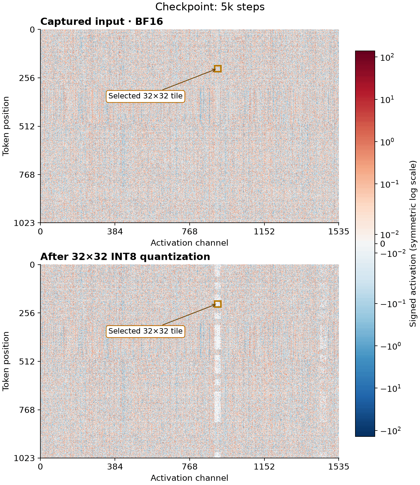
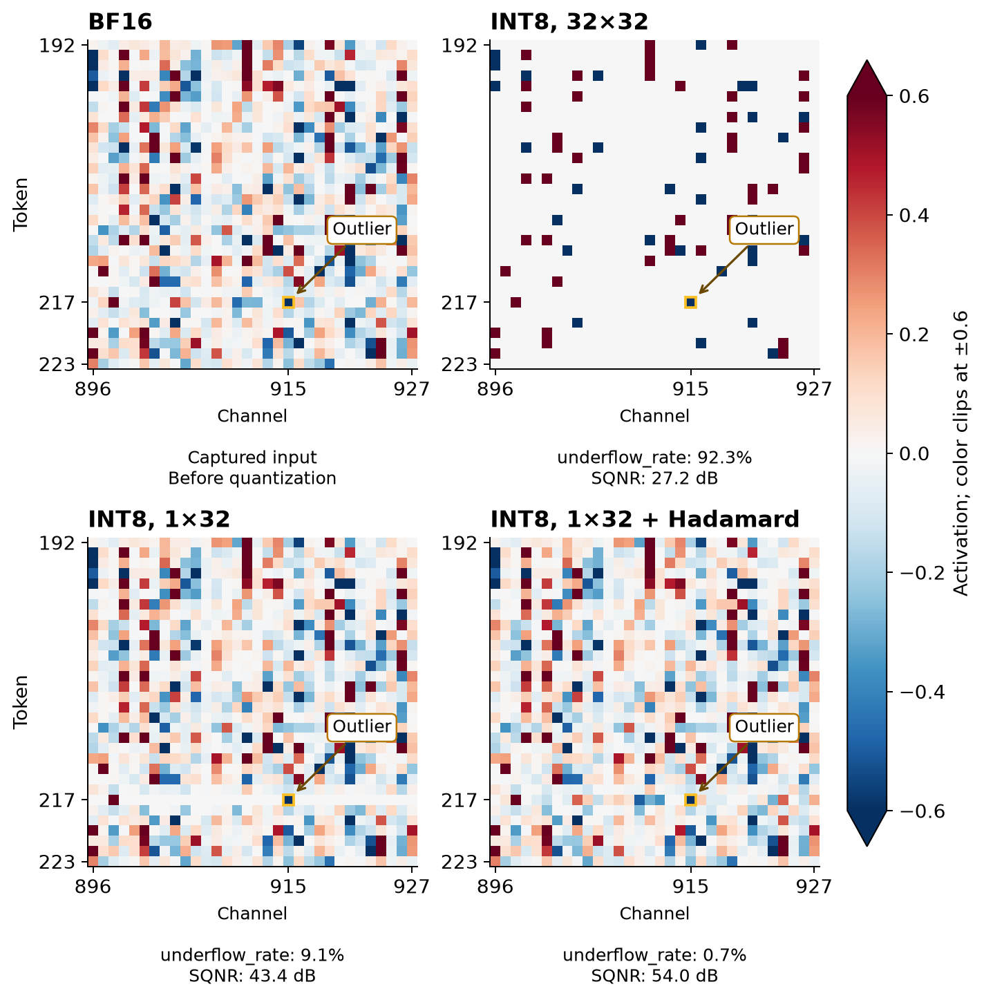
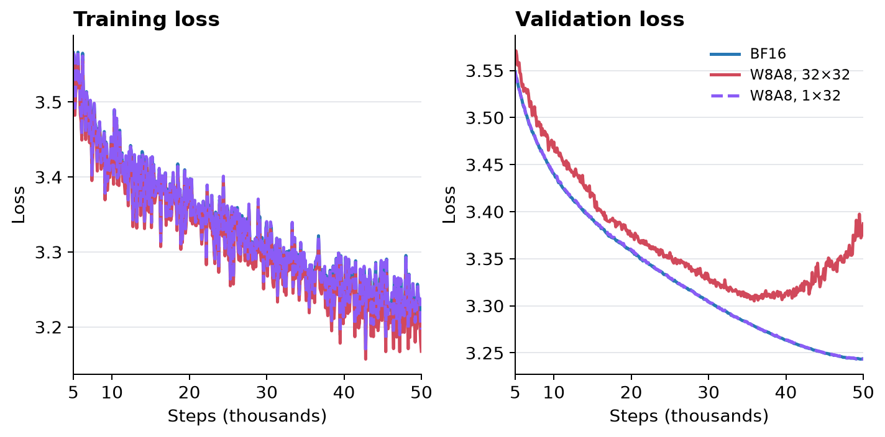

I want to share a common failure pattern of quantization aware training: quantization can leave scars in tensor.

I found this while investigating an INT8 pretraining run where training loss kept falling but validation loss did not converge. Outliers were causing smaller activations sharing their scale to round to zero, leaving visible scars. The interesting part was watching them change during training: some healed, while others stayed until the end.

These scars are usually bad because they round small activations to zero and introduce a systematic bias. The network must adapt to this distortion, which can lead to a higher final validation loss, even fail to converge.

Below is one of the problematic activation tensors: the activation of (`mlp.down_proj`), captured for the same sequence across different training checkpoints. The pale bands show activations rounded to zero. One band faded, but another was still there at 50k steps.

*Same sequence's activation across checkpoints; lower panel: dequantized activations. Colors use a fixed symmetric logarithmic scale.*

The problem with 2D quantization is that a single scale must represent all 1,024 values across 32 tokens × 32 activation channels. A large outlier can cause smaller values across the whole tile to round to zero. This biases smaller activations toward zero, forcing the network to adapt to the resulting distortion during training. 1D quantization can help mitigate this problem.

*Same sequence input with ckpt at 10k steps; colors clip at ±0.6. Orange boxes mark the outlier. Hadamard is tested offline and shown after inverse rotation. `underflow_rate` is the fraction of nonzero inputs rounded to zero, measured before inverse rotation.*

I retrained with 1×32 quantized activations, keeping weight quantization unchanged. The losses converged this time.

*Validation uses BF16 with quantization disabled.*

When scaling up the model size, 1D may not be enough. Outliers can hurt neighboring features sharing the scale, as the [LLM.int8() observations](https://timdettmers.com/2022/08/17/llm-int8-and-emergent-features/) illustrate for vector-wise quantization. If that still breaks training, I'd consider Hadamard rotation to spread outliers before quantization. It improves this tile's signal-to-quantization-noise ratio from 43.4 to 54.0 dB, though I haven't trained with it here. [NVIDIA's NVFP4 training recipe](https://docs.nvidia.com/deeplearning/transformer-engine/features/low_precision_training/nvfp4/nvfp4.html) uses random Hadamard transforms for weight-gradient operands.

Another case to watch out for 2D quantization is attention: sharing quantization scales across tokens can leak future information, even with a causal mask, as [MatX shows](https://matx.com/research/leaky_quantization).

## References

- INT8 pretraining [experiment recipe](https://github.com/gongyisheng/pretrain/tree/main/experiments/int8_activation_granularity)
- Tim Dettmers: [LLM.int8() and Emergent Features](https://timdettmers.com/2022/08/17/llm-int8-and-emergent-features/)
- NVIDIA: [NVFP4 training and random Hadamard transforms](https://docs.nvidia.com/deeplearning/transformer-engine/features/low_precision_training/nvfp4/nvfp4.html)
- MatX: [Future leakage in block-quantized attention](https://matx.com/research/leaky_quantization)
